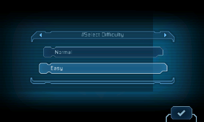

# Dead Space Mobile → New Nintendo 3DS

Экспериментальный порт Android ARM32-библиотеки Dead Space Mobile. **Играбельной сборки пока нет.** Исходники оригинального движка отсутствуют; проект реализует загрузчик ELF и необходимые сервисы Android/JNI для выбранного SD-донора 1.1.33.

**В Azahar видны полные кадры вступительной сцены: планета, корабль, станция и надпись DEAD SPACE.** Меню Normal/Easy и касания работают. CPU baseline прошёл552 ARM-теста; текущие GPU hooks ещё требуют полного повторного прогона. Отдельный GLES→PICA тест проходит, но GPU-интеграция самой игры пока даёт чёрные кадры. Управляемый gameplay, звук и новая игровая CIA не подтверждены; аппаратная проверка остаётся наstage8.

Продолжение: **[HANDOFF.md](HANDOFF.md)**. Текущие адаптеры: [LIGHTING.ru.md](porting/LIGHTING.ru.md), [DEFAULT-SURFACE.ru.md](porting/DEFAULT-SURFACE.ru.md). Машинные сводки: [lighting-result.json](porting/analysis/lighting-result.json) и [engine-progress.json](porting/analysis/engine-progress.json).

Первый логотип EA описан в [FIRST-FRAME.ru.md](porting/FIRST-FRAME.ru.md). Legacy profile124MiB сохранён; расширенный178MiB включает128MiB donor arena. Strict preflight154/234/4 и прежний аппаратный RX backend сохранены. Новые адаптеры включаются явно. Частичная геометрия и законченный чёрный кадр хранятся раздельно; завершение callback не считается доказательством работающего игрового процесса.

Готовы [нижний HID-слой](porting/SENSOR-BACKEND.ru.md) и [его JNI-интеграция](porting/SENSOR-JNI.ru.md). Отдельная native-проверка Azahar получила 40 показаний. Аппаратные оси и калибровка пока не подтверждены. GitHub обновляется только по явной просьбе пользователя.

В репозитории находятся собственные исходники, инструменты сборки, тесты, инструкции и журналы. APK, оригинальная игровая библиотека, ресурсы, toolchain, сторонний reference-проект, эмулятор и его виртуальная SD **не загружаются**. Они остаются в исходной локальной папке. Это резервная копия разработки, не дистрибутив игры.

Рабочая среда: Windows/PowerShell, Python, локальный devkitARM 16.1/libctru 2.7.0, Unicorn 2.1.4 и Azahar libretro 2126.2. Зависимости Python перечислены в [requirements-tools.txt](porting/requirements-tools.txt). При свежем клонировании потребуются собственные игровые файлы и восстановление локальных зависимостей; одних файлов Git для запуска тестов недостаточно. Исторические результаты сохранены как свидетельства, а не как обещание сборки в произвольной среде.
