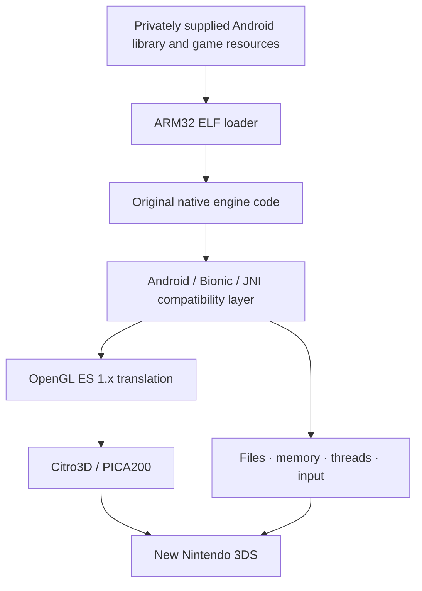

<div align="center">

# Dead Space Mobile → New Nintendo 3DS

**Bringing the original Android engine to Nintendo's dual-screen handheld.**

An experimental native port built around an ARM32 loader, an Android compatibility layer, and PICA200 rendering.


[Screenshots](#screenshots) · [Development Status](#current-development-status) · [How It Works](#how-it-works) · [Building and Testing](#building-and-testing)

</div>

> **Work in progress — stable gameplay has not been achieved.** Real New Nintendo 3DS hardware runs original engine code and the animated intro. Rendering differences and incomplete automatic shutdown remain. There is no finished or fully playable release.

## About the Project

This project explores bringing **Dead Space Mobile** from Android to the **New Nintendo 3DS family**, preserving the original game's engine and presentation while adapting its platform dependencies to 3DS homebrew.

The original engine source code is unavailable. Instead, the port loads a locally supplied Android ARM32 game library and provides the services it needs: ELF loading, Android/Bionic and JNI compatibility, file access, threading, input bridges, and graphics translation. The current donor is the **English SD edition, version 1.1.33**.

For developers, it is a practical experiment in running an existing native engine within a very different graphics API and memory budget. For fans, it is a step toward seeing this part of Dead Space on a new handheld — with substantial work still ahead.

## Screenshots

**All images below are actual Azahar captures, not photographs of a console.** These are development checkpoints; they do not demonstrate stable gameplay or hardware performance.

| Original intro · CPU renderer | Original intro · PICA200 renderer |
| :---: | :---: |
|  |  |
| A clear reference capture from the software renderer. | Original engine output through Citro3D/PICA200; small-text differences remain. |

<p align="center">
  
</p>

<p align="center"><em>Azahar CPU renderer: the original difficulty menu, with Easy selected through the touch bridge. This historical emulator experiment used a larger memory profile; it is not a verified hardware gameplay milestone.</em></p>

[Image provenance and preparation](docs/images/README.md) · [Menu verification](porting/MENU-BOOTSTRAP.ru.md) · [Hardware report](docs/verification.md#hardware-results)

## Current Development Status

**Verified status: November 1, 2026.** Completed entries describe specific milestones, not a complete subsystem or playable game. The [current verification notes](docs/verification.md) summarize the latest local handoff and verified reports. The published [HANDOFF.md](HANDOFF.md) retains earlier engineering history.

| Area | Progress | Verified scope / remaining work |
| :--- | :--- | :--- |
| ARM32 loading and original code execution | ✅ Completed milestone | Original constructors and native callbacks execute on real New 3DS hardware. |
| Animated intro on hardware | ✅ Completed milestone | EA and Isaac/headphone animations observed on the console. |
| Android/Bionic and JNI compatibility | 🧪 Experimental | Services needed by reached engine paths are implemented; coverage is incomplete. |
| CPU graphics and difficulty menu | ✅ Completed milestone | Original frames and touch-driven Normal/Easy selection captured in Azahar. |
| Citro3D / PICA200 rendering | 🧪 Experimental | Original intro frames render; hardware output still differs from the frozen reference. |
| Shutdown and HOME integration | 🧪 Experimental | Manual START retry exited on hardware; automatic shutdown still fails and HOME → X is unverified. |
| Controls and sensors | 🧪 Experimental | Touch and HID/JNI bridges exist; gameplay mapping and hardware calibration remain. |
| Stable, player-controlled gameplay | ⬜ Unfinished | Not demonstrated on hardware. |
| Sound | ⬜ Unfinished | Working game audio has not been confirmed. |
| Performance and scene memory | ⬜ Unfinished | No validated gameplay FPS benchmark or sustained gameplay memory budget. |

The latest **Close 0.1.3** hardware test played both intro animations, then exceeded its automatic cleanup deadline while a late loader continued reading data. A later START retry completed worker shutdown and returned to the HOME Menu. This is **manual recovery success**, not an automatic shutdown pass or verification of closing through HOME → X.

The captured hardware frame still differs from the software checkpoint in **9,231 of 96,000 pixels**. Passing emulator checkpoints does not resolve that difference. Earlier Azahar reload crashes also remain unexplained. Historical diagnostic CIA builds are **not playable releases**; the latest hardware report explicitly says not to repeat the current CIA for more data.

See the [latest hardware findings](docs/verification.md#hardware-results) and the separate [software validation report](docs/verification.md#software-validation).

## Technical Overview

| Component | Approach |
| :--- | :--- |
| Original engine | Load and relocate the Android ARM32 ELF library, bind supported imports, and execute its native code on the 3DS CPU. |
| Platform compatibility | Supply the required Android/Bionic functions, JNI objects and lifecycle calls, file services, memory allocation, and threading. Unsupported paths remain explicit diagnostic stops. |
| Graphics | Translate the engine's OpenGL ES 1.x calls through the compatibility layer. A CPU renderer provides reference output; the DS34 backend uses Citro3D to drive PICA200. |
| Input | Bridge 3DS HID/touch and sensor data into the interfaces expected by the game. End-to-end gameplay controls are still pending. |
| Validation | Use ARM tests in Unicorn, isolated Azahar runs, frame comparisons, and separately recorded hardware observations. |

**Memory is a central constraint.** The current native checkpoint uses a **124 MiB application profile**, with **20 MiB normal heap + 100 MiB linear heap**. A **92 MiB donor arena sits inside that linear heap**, leaving room for SDK/GPU allocations. This budget has supported the intro checkpoint; it does not establish that later gameplay scenes will fit. Older 178 MiB emulator experiments are separate evidence and must not be treated as hardware results.

## Supported Hardware

| Platform | Status |
| :--- | :--- |
| New Nintendo 3DS | Real-hardware original engine and intro execution confirmed; experimental. |
| New Nintendo 3DS XL / New Nintendo 2DS XL | Intended targets in the New 3DS family; separate model-specific gameplay validation is not claimed. |
| Original Nintendo 3DS / 3DS XL / 2DS | Not supported by the current memory profile. |
| Azahar | Development and regression testing; emulator success is not proof of console compatibility. |

Hardware experiments require an already configured homebrew/CFW environment. There is currently no general installation guide or playable package for end users.

## How It Works



The loader prepares executable memory and calls the original engine's constructors and lifecycle functions. Compatibility adapters handle the platform calls reached during execution, and the graphics backend renders the engine's draw commands. The runtime produces the frames itself; reference images are used for validation.

This approach does not boot Android or require the original engine's source code. It does require compatible game files supplied privately by the developer or user, plus further implementation as new engine paths are reached.

## Roadmap

1. **Make automatic shutdown reliable.** Reproduce slow, progressing loader I/O in software tests; add bounded progress-aware completion; then verify automatic exit and HOME → X on hardware.
2. **Resolve rendering differences.** Investigate sampling and small-text differences while retaining the existing frame checks and reference baselines.
3. **Reach a controlled gameplay scene.** Bring difficulty selection and scene loading into the constrained native profile, then verify player-controlled movement and interactions.
4. **Complete handheld controls and sound.** Refine Circle Pad, C-stick, buttons, touch, and sensor mapping; implement and validate audio output.
5. **Improve stability and performance.** Measure real scene memory and frame timing, then optimize rendering, resource access, and allocation based on evidence.

There is no release date. Each step depends on verified results from the preceding work.

## Building and Testing

This is a developer repository, not a self-contained game distribution. A fresh clone lacks the proprietary game files, private test state, toolchain, and emulator setup required by the experiments.

The recorded environment uses **Windows/PowerShell, Python, devkitARM GCC 16.1, libctru 2.7.0, Citro3D 1.7.1, Unicorn 2.1.4, and Azahar libretro 2126.2**. Dependency versions and local setup details are documented in [Development Notes](docs/development.md).

Initial tool setup, from the repository root in a fresh development checkout:

```powershell
python -m pip install --target porting/toolchain/python -r porting/requirements-tools.txt
python porting/tools/bootstrap_toolchain.py --with-emulator
python porting/tools/bootstrap_citro3d.py
```

These commands prepare dependencies; they do not build a playable port or supply the game. Follow the profile-specific documents before building or testing. Builders and runners can write manifests and evidence: preserve existing baselines and use separate output locations for new experiments.

The historical CPU baseline passed **552 ARM tests across 26 suites**. That result belongs to its recorded build, not every subsequent GPU or shutdown change. Current native checkpoint reports cover their own frame, worker-lifetime, I/O, and cleanup checks.

<details>
<summary><strong>Technical documentation and verified reports</strong></summary>

Most existing engineering documents are in Russian; this overview, the development notes, and the verification summary are in English. Links to newer engineering documents use a pinned public development commit. Those documents describe experiments beyond the source code currently on `main`; older documents retain their historical context.

| Topic | Documentation |
| :--- | :--- |
| Current status and earlier chronology | [Verification notes](docs/verification.md) ? [Historical HANDOFF.md](HANDOFF.md) |
| Native checkpoint and memory profile | [Prod124](https://github.com/IvaYar/dead-space-3ds-port/blob/8b1839c207ca51e2afbd73c93639b97ab8bf08b5/porting/3ds/README-native-game-prod124.ru.md) · [Memory report](https://github.com/IvaYar/dead-space-3ds-port/blob/8b1839c207ca51e2afbd73c93639b97ab8bf08b5/porting/analysis/native-game-prod124-v0.1.0/report.ru.md) |
| Current shutdown work | [Close 0.1.3 notes](docs/verification.md#shutdown-work) · [Hardware report](docs/verification.md#hardware-results) |
| Earlier hardware milestones | [DS34 GPU result](https://github.com/IvaYar/dead-space-3ds-port/blob/8b1839c207ca51e2afbd73c93639b97ab8bf08b5/porting/analysis/hardware/ds34-uv-mask-v0.2.1-user-result.json) · [Prod124 startup](https://github.com/IvaYar/dead-space-3ds-port/blob/8b1839c207ca51e2afbd73c93639b97ab8bf08b5/porting/analysis/native-startup-prod124-v0.1.0/hardware-report.ru.md) |
| Color-target initialization and earlier frame failure | [Target-init notes](https://github.com/IvaYar/dead-space-3ds-port/blob/8b1839c207ca51e2afbd73c93639b97ab8bf08b5/porting/3ds/README-native-game-target-init.ru.md) · [Hardware analysis](https://github.com/IvaYar/dead-space-3ds-port/blob/8b1839c207ca51e2afbd73c93639b97ab8bf08b5/porting/analysis/native-game-target-init-v0.1.1/hardware-report.ru.md) |
| Original frames and scene rendering | [First frame](porting/FIRST-FRAME.ru.md) · [Lighting](porting/LIGHTING.ru.md) · [Default surface](porting/DEFAULT-SURFACE.ru.md) |
| Input and sensors | [HID backend](porting/SENSOR-BACKEND.ru.md) · [JNI integration](porting/SENSOR-JNI.ru.md) |
| Shared test resources and publication guard | [Resource-store pilot](docs/verification.md#resource-store-pilot) |
| Machine-readable historical summaries | [Lighting result](porting/analysis/lighting-result.json) · [Engine progress](porting/analysis/engine-progress.json) |

</details>

## Credits and Acknowledgements

- **The original Dead Space Mobile creators and rights holders**, for the game that inspired this work.
- **[IvaYar](https://github.com/IvaYar)**, for this porting project and its hardware testing.
- **devkitPro, devkitARM, libctru, and Citro3D contributors**, for the 3DS homebrew toolchain, libraries, and reference examples.
- **Azahar and Unicorn contributors**, for the emulator and ARM execution tools used during development.
- **The 3DS homebrew and reverse-engineering communities**, for their platform research and documentation.

Selected official devkitPro examples retain their upstream provenance and Public Domain notices. Other third-party components retain their respective licenses; see the development documents for context.

## Legal Disclaimer

This is an **unofficial fan project**, not affiliated with, endorsed by, or sponsored by **Electronic Arts (EA) or Nintendo**. Dead Space and related game content belong to their respective rights holders; Nintendo names and trademarks belong to Nintendo.

The public project documentation does not supply the original APK, proprietary game libraries, extracted assets, fonts, save data, or private diagnostics. Compatible game files must be obtained and supplied separately and lawfully. The selected screenshots illustrate development only; they do not grant permission to redistribute game content. No rights to the original game are granted by this repository.
