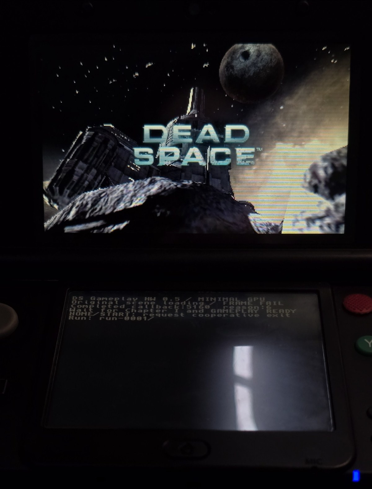
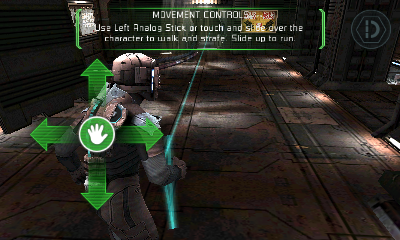
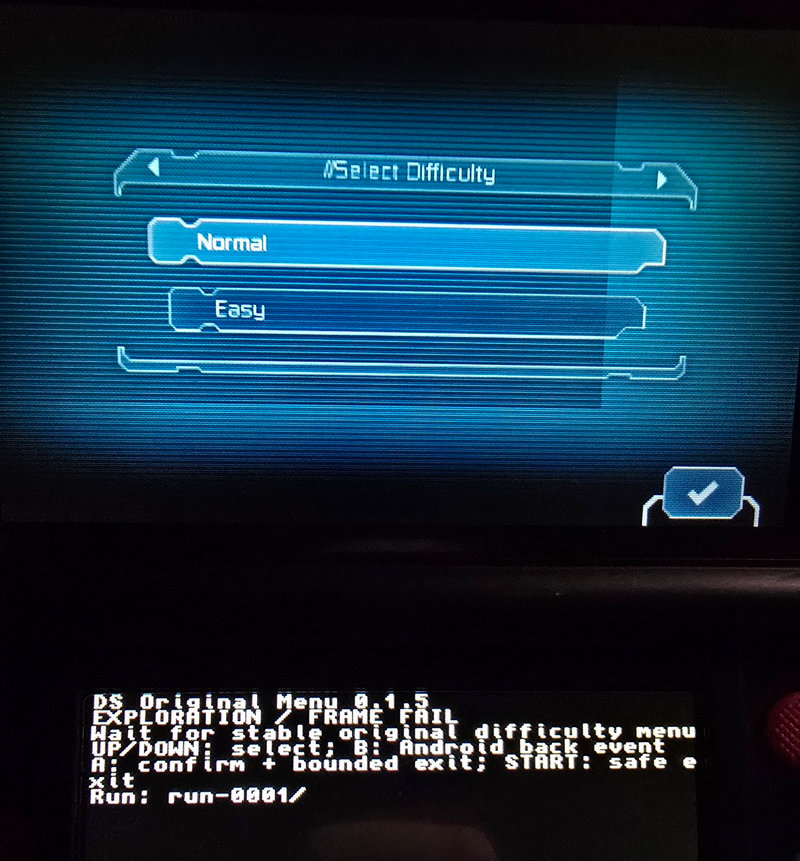
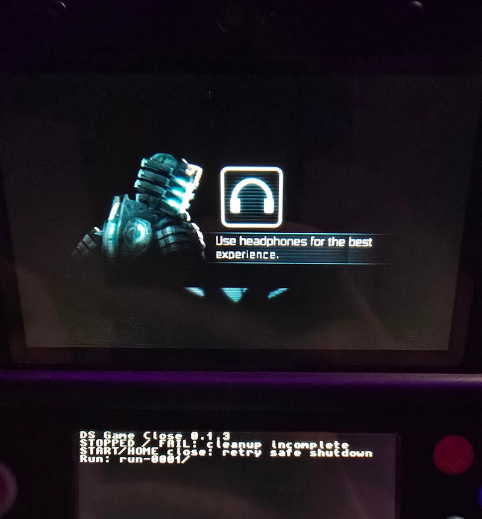

# Dead Space Mobile for New Nintendo 3DS

An experimental, work-in-progress port of the original Android game **Dead Space Mobile** (2011) to the New Nintendo 3DS. The port executes the game's original ARM32 engine natively on the console through a custom Android/Bionic/JNI compatibility layer and translates its OpenGL ES rendering to the 3DS PICA200 GPU via Citro3D.

This is not a reimplementation and not an Android emulator: the original, unmodified game code runs on the 3DS CPU, with only the platform services around it recreated.

  

*Dead Space Mobile running on real New Nintendo 3DS hardware — experimental HW05 build.*

> **Status: experimental port — work in progress.** There is no playable release, no public game build, and no release date. The project is not finished, stable, or complete; see [Current status](#current-status) and [Known issues](#known-issues-and-limitations).

## Contents

- [Current status](#current-status)
- [Confirmed milestones](#confirmed-milestones)
- [How the port works](#how-the-port-works)
- [Technical architecture](#technical-architecture)
- [New Nintendo 3DS hardware limitations](#new-nintendo-3ds-hardware-limitations)
- [Building and running](#building-and-running)
- [Known issues and limitations](#known-issues-and-limitations)
- [Development progress](#development-progress)
- [Credits](#credits)
- [Legal notice](#legal-notice)

## Current status

The most recent hardware test, **HW05**, ran the original game engine on a real New Nintendo 3DS for approximately 75 minutes: the original menu rendered and accepted input, native GPU rendering produced real game visuals, and the run ended at an intentional scene-time budget with a cooperative, fully cleaned-up shutdown. Interactive gameplay has **not** been demonstrated on hardware.

In the **Azahar** emulator, the port goes further: the original game plays its prologue, enters **Chapter I — Honorable Intentions**, and physical character movement through the game's own virtual joystick has been verified. These emulator results still need to be reproduced on the console.

Hardware performance is currently extremely low — approximately one rendered frame per five seconds in the observed scene. This is an informal observation, not a benchmark. A framebuffer CRC mismatch against the frozen reference remains unresolved.

## Confirmed milestones

### On real New Nintendo 3DS hardware — HW05

- Original Dead Space Mobile ARM code executes on the console.
- The original menu renders and accepts input.
- Native GPU rendering produces real game visuals.
- **5,312** original engine callbacks completed.
- **39,738** GPU draw calls; **15,542** GPU submits with zero recorded failed submits.
- Execution continued for approximately 75 minutes until an intentional `SCENE_BUDGET` limit — the run ended at a planned boundary, **not** from a crash.
- No GPU timeout and no memory allocation failure was recorded in that run.
- Cooperative shutdown and safe exit were confirmed: workers joined, GPU drained, cleanup completed, and the process returned to the HOME Menu.

Earlier hardware milestones remain version-specific: intro rendering (0.1.3), HOME → X exit (0.1.4), menu admission (0.1.5), and physical D-pad navigation with Normal/Easy selection and A confirmation through the original engine (0.1.7).

### In the Azahar emulator

- Original menu and **Chapter I — Honorable Intentions** reached through the game's own progression.
- Original game-world rendering: the Chapter I corridor with a character in RIG and the game's MOVEMENT CONTROLS tutorial.
- Full input chain verified: **Circle Pad → original JNI pointer events → the game's own virtual joystick → character controller → physics**, with confirmed forward/backward movement and stopping.
- Texture residency work: lossless Morton/LZ4 backing reduced repeated texture conversion cost within unchanged memory budgets.

### Not yet confirmed on hardware

- Interactive Chapter I gameplay.
- Physical character movement.
- Playable frame rate.
- Camera control, shooting, full audio output, and complete game progression.

## How the port works

The port loads the original ARM32 game library from the Android release and runs its native code directly on the New Nintendo 3DS CPU — both are ARM, so no CPU emulation is involved at runtime. A compatibility layer supplies the Android environment the game expects: Bionic libc services, JNI entry points, threading, memory allocation, file and asset access, sensors, and input bridges. The original engine source code is unavailable, so the engine itself is treated as an opaque, unmodified binary.

The game's OpenGL ES 1.x calls are translated to **Citro3D** command buffers for the **PICA200** GPU, with a separate software renderer kept for debugging and pixel-level comparison. Game textures are converted and stored with lossless **Morton/LZ4** backing to fit the console's tight memory and texture-cache limits.

Input preserves the game's original contract: Circle Pad and touch data are delivered through the original JNI pointer events to the game's own HUD virtual joystick, so the original character controller and physics drive movement — the port does not write character state directly.

## Technical architecture

| Layer | Implementation |
| :--- | :--- |
| Binary execution | Loads the original ARM32 game library, resolves relocations, and runs its code natively on the 3DS CPU. |
| Android/Bionic/JNI layer | Recreates the libc, JNI, threading, memory, file, and sensor services used by the game (`porting/3ds/source`, modules ds6–ds33). |
| Graphics | OpenGL ES 1.x → Citro3D/PICA200 translation with a PICA shader backend (`ds34`); independent CPU renderer for debugging. |
| Textures | Conversion pipeline with lossless Morton-ordered, LZ4-compressed backing; bounded GPU texture cache. |
| Memory | 124 MiB application profile with fixed reservations: 20 MiB normal heap, 100 MiB linear heap, 85.5 MiB donor arena. |
| Input | Original JNI pointer-event contract preserved through compatibility adapters; original virtual joystick, controller, and physics unchanged. |
| Audio | Original mixer runs into a timed PCM sink; audible NDSP output is not yet implemented. |

A deeper description lives in [docs/ARCHITECTURE.md](docs/ARCHITECTURE.md). The working donor is the English Android SD edition **1.1.33**; game files are not part of this repository.

## New Nintendo 3DS hardware limitations

The port operates under tight, measured constraints:

- **Memory.** The 124 MiB application profile is split into fixed reservations (above). Recorded linear-heap peak usage leaves only about **222 KiB** of headroom, so sustained gameplay memory budgets are not yet established.
- **GPU.** The PICA200 is a fixed-function GPU from 2010-era mobile hardware; OpenGL ES states must be mapped onto its combiner pipeline, and unsupported states fail closed by design.
- **Texture cache.** The late-scene working set is about **34 MB** across 25 textures, against an **8 MiB** GPU texture cache — the reason for the Morton/LZ4 backing work.
- **Performance.** Scene rendering is currently extremely slow on hardware (approximately one frame per five seconds in the observed scene; informal observation, not a benchmark).

The target is the **New Nintendo 3DS family**. New 3DS XL and New 2DS XL validation is still pending; the original 3DS, 3DS XL, and 2DS are outside the current memory profile.

## Building and running

The development environment (Windows/PowerShell, Python, devkitARM, libctru, Citro3D, Unicorn, Azahar) and the source layout are documented in [docs/development.md](docs/development.md). The toolchain setup is reproducible from this repository, but building a runnable game package additionally requires your own lawfully obtained copy of the original game files, which are not and cannot be distributed here.

There are **no public releases**. Earlier diagnostic CIA packages were internal hardware tests, not game builds; please do not install anything expecting a playable port.

## Known issues and limitations

- **Framebuffer CRC mismatch unresolved.** The sticky `FRAME FAIL` gate against the frozen reference frame (`ea733050`) remains in place and has not been weakened or declared fixed.
- **Extremely low hardware performance** in the game scene (see above).
- **No audible sound output.** The original audio mixer runs into a timed PCM sink; an NDSP backend is pending.
- **Gameplay not confirmed on hardware.** Movement, camera, shooting, and progression are verified only up to the limits listed under [Confirmed milestones](#confirmed-milestones).
- **Console coverage.** Only New Nintendo 3DS has been exercised; XL variants are unvalidated, and original 3DS models are unsupported by the memory profile.

## Development progress

High-level timeline, newest first:

| Milestone | Result |
| :--- | :--- |
| **HW05 hardware run** | 75-minute original-engine run on a real New 3DS: menu rendering and input, native GPU visuals, 5,312 callbacks, zero failed submits, clean cooperative exit at an intentional scene budget. |
| **gameplay07 (Azahar)** | Original movement chain verified end to end: Circle Pad → JNI → virtual joystick → character controller → physics; forward/backward movement and stopping confirmed. |
| **Chapter I (Azahar)** | Original prologue and Chapter I corridor rendered through the Citro3D/PICA200 backend; MOVEMENT CONTROLS tutorial visible at callback 5,106. |
| **Texture residency (Azahar)** | Lossless Morton/LZ4 backing; ~32× faster early-prologue callbacks and ~2.24× in the late station window, within unchanged budgets. |
| **HID 0.1.7 (hardware)** | Physical D-pad navigation, Normal/Easy selection, and A confirmation through the original engine, with the intended safe exit. |
| **0.1.3–0.1.4 (hardware)** | Original intro rendering; verified HOME → X cooperative exit. |

Detailed numbers and evidence scope: [docs/verification.md](docs/verification.md). Milestone-by-milestone history: [docs/DEVELOPMENT_STATUS.md](docs/DEVELOPMENT_STATUS.md). The full engineering chronology (in Russian): [HANDOFF.md](HANDOFF.md).

Next steps, in no fixed order: reproduce Chapter I gameplay on hardware, address scene performance, resolve the framebuffer CRC mismatch, and add audible NDSP output.

## Credits

Port development, reverse engineering, and hardware testing by [IvaYar](https://github.com/IvaYar).

Thanks to the original Dead Space Mobile team; the devkitPro, libctru, and Citro3D contributors; the Azahar and Unicorn developers; and everyone documenting the Nintendo 3DS for homebrew. LZ4 is used under its BSD license; devkitPro example code retains its upstream notices.

## Legal notice

This is an unofficial, independent fan project. It is not affiliated with, endorsed by, or connected to Electronic Arts or Nintendo. **Dead Space** and related content are the intellectual property of their respective rights holders, including Electronic Arts. Nintendo 3DS is a trademark of Nintendo.

No original game files, libraries, or assets are included in this repository, and this project grants no rights to the original game. You must supply your own lawfully obtained copy of the game to reproduce any runnable build. Third-party components retain their respective licenses.

---

More captures: Chapter I in Azahar and earlier hardware photographs

  

*Chapter I in Azahar, through the port's Citro3D/PICA200 backend. This is an emulator capture, not a console photograph. [Full capture](docs/images/azahar-chapter-one.png).*

  
  

*The difficulty menu in 0.1.5 and the intro in 0.1.3. Menu controls were subsequently verified in 0.1.7. [Image notes](docs/images/README.md).*

