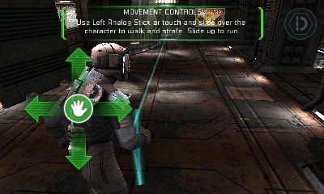

# Dead Space Mobile — New Nintendo 3DS Port

[Русский](README.ru.md) · [Build](playable/BUILD.md)

An unofficial experimental homebrew port loading the original Android ARM engine on **New Nintendo 3DS / XL / LL**, through a native compatibility layer. Bring your own legitimately obtained game data. No Android APK, commercial engine library or texture cache is distributed here.

## First playable v0.1.0

Normal launch now starts the original engine automatically after the automatic SD safety check. No mandatory button preflight, readiness activation or X test. Original menus, resource loading and cinematic progression remain. Native readiness still gates movement and camera. Optional developer mode retains the old diagnostic sequence.

The user reports that the preceding Phase8 build works well on a physical New 3DS LL, including HQ textures and both sticks. This report is not new-CIA hardware validation. Phase9 must be tested physically by the user.

Features: original engine/game logic and physics; PICA200 rendering; HQ ETC1/ETC1A4 cache; Circle Pad movement; original Xperia input path for C-Stick camera; input batching/freshness; CPU geometry optimizations; three fullscreen backdrop/fade corrections; bounded watchdogs and cooperative GPU/worker shutdown. Save/load and full-campaign completion are **not verified**.

## Requirements and installation

New 3DS family, compatible Luma3DS/CFW and FBI (or an equivalent installation method), FAT32 SD, and your own compatible original data. Old 3DS is untested. Automatic safety preflight requires at least **1 GiB free**, in addition to game files (about 584 MB) and prepared cache. Supported donor is **Universal SD 1.1.33**, not an interchangeable Xperia APK: library SHA256 `dd42272365d0abd8ad9c89450bb7f869ee4ac0ad548525758e6a1e7df4d3c1eb`; APK SHA256 `0d3c870ae38687e1ac7e8dbf0ca8568862437491529e8ef45b818f4c38958845`.

1. Extract your own matching library, published assets and APK assets locally, preserving the structure below. Verification markers must reflect verified data; do not create arbitrary PASS markers. Existing validated Phase8 SD data/cache can be reused unchanged. The matching licensed font subset is also required; it is not supplied here.
2. Place files as ordinary SD files, without an extra archive directory:

```
/3ds/deadspace/libEAMGameDeadSpace_orig.so
/3ds/deadspace/assets/published/...
/3ds/deadspace/apk-assets/EAMCore.ini
/3ds/deadspace/apk-assets/...
/3ds/deadspace/test-output/font-subset/Ascender_Uni.ttf
/3ds/deadspace/assets-verified.txt
/3ds/deadspace/apk-assets-verified.txt
/3ds/ds-hq-prepared/etcq/*.bin
```

3. Build the ELF and package a CIA locally using [BUILD.md](playable/BUILD.md). Install the CIA through FBI. No CIA is attached to the public release: banner/icon and redistribution rights have not been cleared. This source branch does not contain a full automated game-data/cache preparation pipeline; new users must prepare compatible private data before installing.
4. Launch from HOME Menu. The engine starts automatically; select difficulty with D-pad and continue with A. Wait for original gameplay loading; no X activation is required. HQ-cache is reused; missing prepared blocks use the older BALANCED fallback.

TitleID `000400000FE11000`, ProductCode `CTR-H-P901`, runtime `/3ds/ds-p9-playable/` are separate from Phase8. Diagnostic journals remain private in its `run-xxxx`/`preflight-xxxx` folders.

## Controls

|Input|Implemented mapping|
|---|---|
|Circle Pad|Original HUD joystick movement after readiness|
|C-Stick|Camera, native Xperia right-pad path; works together with movement|
|D-pad Up/Down|Original menu difficulty selection|
|A|Original menu confirmation / Chapter I|
|B|Original Android Back event|
|X|No required action in normal mode; marks movement test in developer mode|
|Y, L/R, ZL/ZR, SELECT|No additional gameplay mapping verified|
|START|Cooperative exit; wait for cleanup|
|Touchscreen|Direct stylus/QTE gesture support is not verified; do not assume it works|

Optional empty files, read at startup: `/3ds/ds-p9-playable/developer-mode.txt` enables the old SD/HID/X diagnostic procedure; `cstick-off.txt` disables camera; `frame-timing.txt` enables bounded presentation timestamps, not a correct-frame FPS counter. File flags avoid conflicting button combinations.

## Performance and known issues

Phase8 fresh Azahar cinematic interval improved about **4.81% guest time** over Phase7; host wall was effectively similar. That is not a physical FPS speedup. Hardware smoothness is user-reported; stable 15 FPS, frame pacing and physical latency remain unmeasured. Phase9 is packaging/startup work, with no new performance claim.

Historical FRAME CRC remains FAIL; scoped image regressions are separate from unresolved full image fidelity. A negative buffered-read length was guarded, but its original trigger and all parser error-recovery paths remain unknown. Keep crash journals. A readiness transition releases input and waits for original readiness again; it does not force game state. Full campaign, all menus, save/load, audio fidelity and touchscreen QTE coverage remain incomplete.

Normal mode is bounded by a four-hour post-readiness watchdog and a million-callback ceiling, with the original startup deadlines retained. Developer mode keeps old test budgets. GPU drain waits remain bounded; resources are retained if shutdown cannot complete. On `STOPPED / cleanup incomplete`, this is not loading: use START/HOME as instructed. Never remove SD while running; use normal POWER shutdown if unresponsive.

Roadmap: verified stable 15 FPS, more efficient renderer, lower input latency, bottom-screen UI, touchscreen QTE gestures, camera tuning and full game compatibility.

## Screenshots and credits



This is an **earlier emulator screenshot**, not a physical Phase9 photo. Existing labeled hardware photographs remain in docs/images; they are historical evidence, not validation of the new package.

Dead Space Mobile was developed by IronMonkey Studios and published by Electronic Arts; see [EA’s original announcement](https://news.ea.com/press-releases/press-releases-details/2011/EA-Delivers-the-First-Big-Blockbuster-Game-of-2011-With-Dead-Space-2/default.aspx). This unofficial project has no affiliation with EA or Nintendo and claims no ownership of the game. Thanks to devkitPro/devkitARM, libctru, Citro3D, LZ4, Azahar, Unicorn, and the interoperability research of deadspace-vita and EapRules/deadspace-native-arm. Their licenses and existing author notices remain applicable; see playable/LICENSE-NOTICE.md and the existing vendor licenses.
