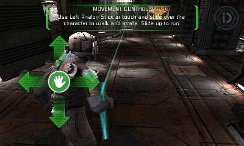

# Dead Space Mobile — порт для New Nintendo 3DS

[English](README.md) · [Сборка](playable/BUILD.md)

Неофициальный экспериментальный homebrew-порт оригинального Android ARM-движка для **New Nintendo 3DS / XL / LL**. Нужны собственные законно полученные игровые данные. APK, original donor library и proprietary texture cache не распространяются.

## Первый playable v0.1.0

HOME Menu → автоматическая проверка SD → original engine/menu/cinematic → gameplay.
Обязательной проверки кнопок, активации readiness и X-теста в обычном режиме нет.
Настоящая readiness, проверки памяти/ввода, GPU sync, watchdog и cooperative shutdown сохранены.
Пользователь протестировал Phase9 на физической New Nintendo 3DS LL: по его оценке, игра работает примерно в **1,5–2 FPS**. Это пользовательская оценка, а не инструментальное измерение времени кадров.

Сохранены original engine/physics, HQ ETC1/ETC1A4, Circle Pad, C-Stick, совместное управление, CPU-оптимизации и три исправления fullscreen backdrop/fade. Save/load и прохождение всей игры не подтверждены.

## Установка

Нужны New 3DS, совместимая Luma3DS/CFW, FBI, FAT32 SD и минимум 1 GiB свободно сверх файлов игры. Old 3DS не проверялась. Поддерживается Universal SD 1.1.33; точные hashes donor/APK указаны в English README. Произвольный Xperia APK не заменяет выбранный donor.

1. Подготовить собственные совместимые library/assets/font и настоящие verification markers. Уже проверенная SD Phase8 подходит без изменений. Полного нового автоматического extraction/cache pipeline в этой ветке нет; не создавать ложные PASS markers.
2. Сохранить обычные файлы по путям:

```
/3ds/deadspace/libEAMGameDeadSpace_orig.so
/3ds/deadspace/assets/published/...
/3ds/deadspace/apk-assets/EAMCore.ini
/3ds/deadspace/apk-assets/...
/3ds/deadspace/test-output/font-subset/Ascender_Uni.ttf
/3ds/deadspace/assets-verified.txt
/3ds/deadspace/apk-assets-verified.txt
/3ds/ds-hq-prepared/etcq/*.bin
```

3. Собрать локально по playable/BUILD.md, установить CIA через FBI. Публичная CIA не выкладывается: права на banner/icon не установлены. Частный архив HQ-cache, если он уже есть, распаковывать в корень SD, без лишней папки.
4. Запустить из HOME Menu. Дождаться original menu, UP/DOWN выбирают сложность, A продолжает Chapter I. После загрузки управление включается по настоящей readiness автоматически.

TitleID `000400000FE11000`, ProductCode `CTR-H-P901`, runtime `/3ds/ds-p9-playable/`. Старый title Phase8 не заменяется.

## Управление

|Кнопка|Фактическая функция|
|---|---|
|Circle Pad|Движение через original HUD joystick|
|C-Stick|Камера через native Xperia right-pad; совместим с движением|
|D-pad UP/DOWN|Original menu/difficulty|
|A / B|Подтверждение меню / Android Back|
|X|В обычном режиме не требуется; marker теста в developer mode|
|Y, L/R, ZL/ZR, SELECT|Дополнительный gameplay mapping не подтверждён|
|START|Cooperative exit, дождаться завершения|
|Touchscreen|Прямой stylus/QTE путь не подтверждён|

Флаги в корне runtime, вне run-xxxx: `developer-mode.txt` возвращает прежний SD/HID/X тест; `cstick-off.txt` выключает камеру; `frame-timing.txt` включает ограниченные presentation timestamps, не доказательство FPS. По умолчанию этих файлов нет.

## Ограничения и планы

Текущая Phase9 на физической New Nintendo 3DS LL работает примерно в **1,5–2 FPS по оценке пользователя**. Стабильные 15 FPS не достигнуты; инструментальные измерения frame pacing и физической задержки ввода ещё не выполнены. Phase8 дала −4,81% guest cinematic time в Azahar против свежей Phase7; host wall почти одинаковый. Это emulator result, а не аппаратный FPS speedup. Phase9 не заявляет нового ускорения оптимизациями. Полная image fidelity остаётся UNRESOLVED, historical FRAME FAIL сохранён. Защищён отрицательный read→memcpy, но причина старой ошибки и полное parser recovery неизвестны. Кампания, save/load, audio fidelity и touchscreen QTE не проверены полностью.

Обычная сессия ограничена watchdog 4 часа после readiness и 1 млн callbacks; прежние startup deadlines сохранены. Переход readiness отпускает жесты и ждёт настоящего admission, не пишет game state. При STOPPED / cleanup incomplete это остановка, не загрузка: START/HOME запрашивает закрытие. Не извлекать SD на работающем приложении. При полном зависании использовать обычное выключение POWER.

Далее: подтверждённые 15 FPS, renderer/input latency, нижний экран, QTE touchscreen, настройка камеры и полная совместимость.



Credits и лицензии — в English README и playable/LICENSE-NOTICE.md. Оригинальная игра: IronMonkey Studios / Electronic Arts; проект не связан с EA/Nintendo и не претендует на права игры.
