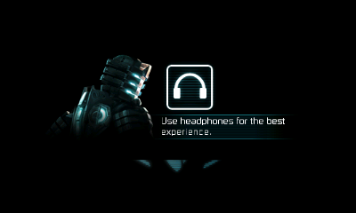
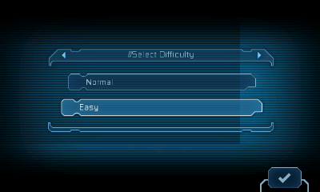

# Images

## Photographs in the project README

Both photographs were supplied by the project author in this conversation and show a **real New Nintendo 3DS**. They were not generated or reconstructed from emulator output.

| File | What is shown | Limits |
| :--- | :--- | :--- |
| [hardware-menu.jpg](hardware-menu.jpg) | Original Select Difficulty screen in **Menu 0.1.5**. | Normal is highlighted; physical navigation did not pass this test. The lower screen's FRAME FAIL message remains visible. |
| [hardware-intro.jpg](hardware-intro.jpg) | Original Isaac/headphone screen in the earlier **Close 0.1.3** run. | The photo retains STOPPED / cleanup incomplete. Later 0.1.4 tests improved automatic exit; this older photo is not the latest shutdown result. |

The supplied 1441 × 2560 PNG attachments were cropped to retain the upper game display, console bezel, and lower diagnostic text, then resized to 800 × 861 and compressed as JPEGs. Unnecessary surrounding and blank lower-screen area was removed. No retouching, color correction, perspective reconstruction, generated content, or replacement screen was used. EXIF and other source metadata were not carried into the public files. Full-resolution originals remain private.

The menu photograph does not prove input works, and readable intro text does not establish pixel equality to the frozen reference. See [current results](../verification.md).

## Earlier Azahar captures

These existing screenshots remain available as development references. They are **emulator captures, not photographs of hardware**.

| CPU intro | PICA200 intro | CPU difficulty menu |
| :---: | :---: | :---: |
|  |  |  |

- [azahar-intro-cpu.png](azahar-intro-cpu.png) comes from [headphone-frame/first-game-frame.png](../../porting/analysis/headphone-frame/first-game-frame.png). It is a historical CPU-renderer checkpoint, not the current native-game CRC oracle.
- [azahar-intro-pica200.png](azahar-intro-pica200.png) comes from [gpu-engine-first/first-game-frame.png](../../porting/analysis/gpu-engine-first/first-game-frame.png). Its distorted small text is an emulator observation, not proof of a physical PICA200 defect. It is a separate capture, not a synchronized comparison to the CPU frame.
- [azahar-difficulty-menu.png](azahar-difficulty-menu.png) comes from [menu-frame/easy.png](../../porting/analysis/menu-frame/easy.png), a historical CPU menu experiment using a 178 MiB emulator profile and elevated CPU setting. It is distinct from the new native hardware menu result.

These three PNG copies retain their original 400 × 240 dimensions and decoded pixels. They were prepared as lossless RGB PNGs without metadata; their source captures remain unchanged. For background, see [headphone-screen notes](../../porting/HEADPHONE-SCREEN.ru.md), [menu verification](../../porting/MENU-BOOTSTRAP.ru.md), and [HANDOFF.md](../../HANDOFF.md).

Game imagery belongs to its respective rights holders and is included to document this unofficial project. It does not grant permission to redistribute the game or its resources. Each selected image received separate publication review; the general staged-file guard remains conservative about binary files.
