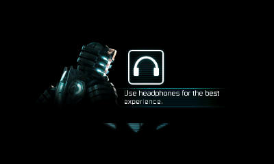

# Касания и приватные файлы: проверены240 кадров

Текущий checkpoint от28 октября2026: **добавлены настоящий Android pointer callback и запись appdata через файловые дескрипторы**. На стандартной частоте Azahar100% оригинальный движок завершил240 кадров, получил DOWN/UP и создал файлы настроек/статистики. Изображение пока остаётся экраном с персонажем и наушниками; главное меню, звук и игровой процесс не подтверждены.



Машинный результат — [input-save-result.json](analysis/input-save-result.json), подробный журнал — [run.log](analysis/input-save-frame/run.log). Снимок CPU framebuffer проверен по CRC/PNG и реальному [LCD Azahar](analysis/input-save-frame/azahar-screen.png). Новой CIA и запроса на SD-тест нет. Изменения этого продолжения локальные; GitHub — только по новому запросу пользователя.

## Ввод

`ds23_touch.c/h` передаёт один pointer через оригинальный `TouchSurfaceAndroid.NativeOnPointerEvent(IIIFF)V`. Проверены DEX декларация и ARM getters выбранного донора: module1000, DOWN0x6000c/MOVE0x4000c/UP0x8000c/CANCEL12. Float coordinates передаются по Android softfp ABI, включая stack arguments.

Нижний экран320×240 преобразуется в логическую поверхность400×240. Неподвижное удержание не повторяет DOWN; UP использует последние координаты. Выход за границы и невалидные pressed values не меняют состояние. Close отправляет CANCEL удерживаемому pointer. Callback вызывается последовательно с render thread; borrowed JNI context должен жить до close.

`GetTouchScreenCount` сообщает1 только после подключения backend. `TouchSurfaceAndroid.IsTouchScreenMultiTouch()Z` возвращает false для этого однопальцевого профиля, при отсутствии backend запрос отклоняется. Настоящий hardware touch ещё не проверялся; CPU-тесты проверяют преобразование и ABI, а native-прогон — возврат оригинального callback. Два scripted events на кадрах160/161 прошли через тот же адаптер, который получает HID samples. Реальное касание через input frontend пока отдельно не автоматизировано.

Также добавлен opt-in вызов оригинальных NativeOnResume и NativeOnWindowFocusChanged после инициализации движка. Обе функции возвращаются. Эти события и касание сами по себе экран наушников не закрыли.

## Файлы и ошибки

Журнал показал повторяющиеся отказы EROFS/EINVAL для `appdata://var/settings.sb`, `AchievementsSave.sb` и `00_LevelSave.sb`. `ds24_files.c/h` добавляет opt-in open/read/write поверх прежнего пула8 дескрипторов и совместимых native FILE handles. Старые lseek/close/fstat/fdopen сохраняют доступ к handle. Observer закрытия сбрасывает запись владельца даже при закрытии через старый API.

Поддержан ограниченный набор Android ARM flags: RDONLY/WRONLY/RDWR, CREAT, EXCL, TRUNC, APPEND, LARGEFILE. Они переводятся в native constants; Android integers не передаются в newlib напрямую. Контракт сверяет `verify_private_flags.py` с Bionic android-2.3.3_r1. Неизвестные флаги и неподдержанные сочетания отклоняются. Чтение/запись неверного access mode даёт EBADF. Capacity проверяется до открытия, чтобы обычное исчерпание пула не успевало обнулить файл.

Запись разрешена только в `appdata:/`, для нового режима — `sdmc:/3ds/deadspace/test-output/save-bridge/`. Namespace выбирается до открытия файлов, имя ограничено безопасными символами; root/paths проходят прежнюю проверку traversal. Оригинальные assets остаются read-only. Native backend использует unbuffered FILE, чтобы descriptor writes были сразу видимы другому descriptor; clearerr перед descriptor reads позволяет снова читать после прежнего EOF.

Обнаружено также, что native file device иногда возвращает отрицательный Horizon FS Result прямо в errno. Подтверждённый0xc82044be обозначает AlreadyExists. `ds6_host_error` теперь переводит только известные FS descriptions112/113/120 в ENOENT и180/185/190 в EEXIST; неизвестные ошибки остаются EIO. Это проверено ARM-тестом и native exclusive-create probe. Первичный reference — [Azahar file-system errors](https://github.com/azahar-emu/azahar/blob/master/src/core/file_sys/errors.h).

Native probe прошёл write/read/seek/close/reopen/append/EXCL/fstat и отказ записи в asset. В отдельной папке остались настоящие файлы игры: settings468 bytes, AchievementsSave1536 bytes,00_LevelSave972 bytes. Сохранены размеры и SHA в [save-receipt.json](analysis/input-save-frame/save-receipt.json); содержимое этих файлов не добавляется в Git. Полноценная загрузка кампании из сохранения ещё не проверена.

Существующий файловый адаптер требует сериализации вызывающей стороной. Это продолжение не превращает общий descriptor/stdio pool в полноценную concurrent POSIX filesystem; аудит пересечений фоновых users остаётся отдельной работой. Неполная production-привязка по-прежнему отказывается исполняться: strict154/234/4, GL99 и дополнительные FS overrides включены только в тестовых профилях.

## Запуск и наблюдения

Прошли **368 core ARM-тестов**: прежние336 +14 touch +18 private-files. Повторены9 штатных Azahar cases и3 guarded CPU modes. Отдельные14 isolated sensor-тестов сохраняют собственную актуальную цепочку hashes. Дополнительный120-frame headphone run и новый240-frame input/save run проверяются отдельными checker. Переснятый120-frame run использует resume/focus, touch и private-files без scripted tap. `check_input_save.py` проверяет текущие source/core/CXI hashes, все240 returns, original callbacks, native file probe, GL/JNI состояние, сохранённые файлы и raw/PNG/LCD.

Длинные прогоны получили отдельный ограниченный watchdog900 emulated seconds; стандартные проверки сохраняют150. На успешной графической остановке приложение держит code/arenas живыми и спит до выключения эмулятора frontend: оно не выгружает код из-под donor workers. Runner записывает параметры профиля. Host OSError из DLL сохраняется как failed result и завершает отдельный Python process без опасного зависшего unload; такая ошибка не считается пройденным тестом.

Наблюдались отдельные нестабильные host-прогоны: access violation внутри DLL и C++ exception после native process exit. Успешный240-frame checkpoint сохранён отдельно и проверен; не следует объявлять длительную работу полностью стабильной. Пробовалась частота400%, но она не открыла меню и не используется как каноническое доказательство.

Clock trace показывает продвижение gettimeofday, а не замершие часы. На checkpoint заняты34 mutex и31 semaphore; добавленный observer не сообщил об исчерпании semaphore pool. Повышать capacity вслепую оснований пока нет. Один version-string loan сохраняется до cleanup; pending0/frame-depth0.

**Важное новое уточнение:** в оригинальном SD APK действительно есть EAMCore.ini3119 bytes, EAMToolManager.ini и другие bootstrap assets; всего20 entries под assets/, включая большой bundled-game.zip,7 immediate root children. Их metadata и SHA выбранного APK сохранены в [apk-asset-namespace-contract.json](analysis/android-abi/apk-asset-namespace-contract.json). Нынешний AssetManager bridge использует виртуальный published root внешнего cache, поэтому три прежних fallback errors нельзя считать доказательством отсутствия соответствующих файлов в APK. Полный APK namespace ещё не реализован. Следующий обоснованный блок — корректно развести APK assets и external cache, сохраняя истинные open/list semantics и не подставляя фиктивные data.zip/пустые списки. Это установленный пробел адаптера; причинная связь именно с зависанием headphones screen пока не доказана.

## Воспроизведение

Azahar cases запускать последовательно, они используют одну приватную SD. После rebuild сначала обновить привязанные к нему core tests и runtime witnesses.

```powershell
python porting/tests/test_touch.py
python porting/tests/test_private_files.py
python porting/tests/smoke_engine_azahar.py --case graphics --explore --capture-frame 240 --timeout-seconds 120 --resume-focus --touch --tap-frame 160 --private-files
python porting/tools/check_first_frame.py
python porting/tools/check_headphone_frame.py
python porting/tools/check_input_save.py
python porting/tools/check_engine_progress.py
python porting/tools/check_sensor_progress.py
```

Для обновления снимка и receipt скопировать текущие raw/json через `export_native_frame.py --output-directory porting/analysis/input-save-frame`, exploratory log/result как run.log/run-result.json и LCD как azahar-screen.png. Exporter отклоняет старый framebuffer, если текущий journal не подтверждает соответствующий завершённый capture. Receipt относится к остановленному native run: копии трёх var-файлов хранятся локально в ignored `analysis/input-save-state/var/` и проверяются по receipt, чтобы последующие прогоны могли обновлять рабочие saves. Эти копии, как и сами saves, не загружаются в Git. Не переписывать hashes, выдавая старый снимок за результат новой сборки.
