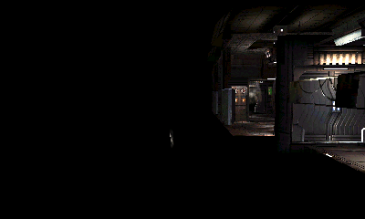

# DS32: освещение GLES1.1

**Native checkpoint завершён:** lighting + default depth/stencil дали completed frame2605 с GL0, failures0. В отдельном промежуточном кадре2604 виден коридор; окончательный2605-й кадр чёрный. Это следующий исследуемый дефект, не повод снова реализовывать LightModel. Текущая полная CPU-база —551 тест.

Снимок сохраняется только после lit draw и обнаружения ненулевых pixel bytes. Он не выдаётся за завершённый кадр: в `lighting-result.json` отдельно указаны `geometry_visible_in_intermediate=true`, `output_is_black=true`, `visible_scene_confirmed=false`. Дальше требуется сопоставить поздние passes, их textures/alpha и время перехода сцены. В журнале есть первые32 vertex samples и крупные draws; этот бюджет мог закончиться до последних overlay draws.

Опциональный `--lighting` добавляет18 функций lights/materials/light-model/normal и реальное per-vertex освещение в CPU renderer. Legacy GL99 без флага остаётся отдельным профилем. Исходные ресурсы игры не изменяются.

Реализованы8 источников: directional/positional, ambient/diffuse/specular, затухание по расстоянию и прожектор с cutoff/exponent. Материал содержит ambient/diffuse/specular/emission/shininess; alpha берётся из diffuse. Общий ambient и two-sided mode имеют отдельное состояние. Используется модель с бесконечно удалённым наблюдателем, предусмотренная GLES1.1.

Положение света преобразуется modelview при задании и хранится в eye-space. Направление прожектора преобразуется линейной частью modelview, **не обратной матрицей**. Нормали вершин, напротив, преобразуются inverse-transpose; поддерживаются NORMALIZE/RESCALE_NORMAL. Обратная4×4 матрица вычисляется один раз на draw; вырожденная/непредставимая матрица вызывает явный guard до изменения пикселей.

При two-sided lighting front/back цвета вычисляются раздельно и выбираются по winding/front-face. Оба набора проходят clipping и flat-shading с сохранением provoking vertex. Для normal arrays byte/short применено нормализованное signed-преобразование, для vertex arrays сохранена прежняя числовая интерпретация.

COLOR_MATERIAL сразу обновляет ambient/diffuse, отслеживает Color4 и color arrays и сохраняет изменения после отключения. В этом профиле current color и material colors хранятся без преждевременного clamp; clamp применяется к результату освещения. Fixed16.16 entrypoints и float/fixed getters работают с собственными преобразованиями. Getter материалов принимает FRONT/BACK, setter — FRONT_AND_BACK.

Контракт сверялся с [GLES1.1.12, разделы2.10.3,2.12 и6.1.3](https://registry.khronos.org/OpenGL/specs/es/1.1/es_full_spec_1.1.pdf). Для неопределённых спецификацией случаев выбраны ограниченные результаты: нулевая normal/direction нормализуется в ноль, нулевой знаменатель attenuation даёт множитель1. Это не расширяет заявленную совместимость на неопределённые входы.

`tests/test_lighting.py`:28 ARM-тестов с настоящими RGBA/FBO-пикселями, включая позиции/прожекторы, specular, затухание, inverse-transpose/shear/scale, two-sided clipping, signed normal arrays, color-material persistence, fixed API и ошибочные параметры. Вместе с прежними проверками —539 тестов; новые native witnesses ещё готовятся. Последняя полностью согласованная контрольная точка до этой работы — коммитa3775e9 с511 тестами.
